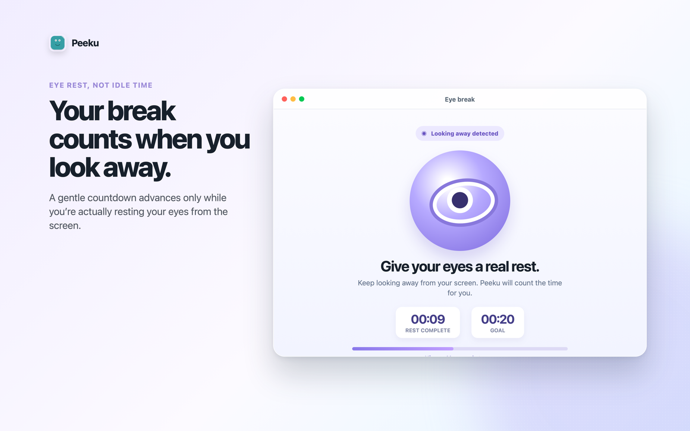

# Peeku

Peeku reminds you to rest your eyes and take a walk while you work at your Mac. If you enable Auto Lock, Peeku can start the screen saver when you leave your desk. It checks the camera image on your Mac. Camera frames stay on the device.

**[Download Peeku from the Mac App Store](https://apps.apple.com/app/id6773651327?mt=12)** · macOS 14 or later · Free, with optional in-app purchases

[Join the one-week Mac trial](https://github.com/iamitp/peeku-releases/issues/1).

## Try walk-away locking

In Peeku Settings, enable **Auto Lock** and choose how long Peeku should wait after you leave. For a password lock, go to **System Settings → Lock Screen** and set **Require password after screen saver begins or display is turned off** to **Immediately**. Try looking away while seated, then step out of the camera’s view. Peeku checks whether someone is still in the wider frame before starting the screen saver.

[Watch the 16-second walk-away illustration (MP4)](https://peeku.app/assets/peeku-walkaway-demo.mp4), made with screenshots from Peeku 1.3.

Peeku also has a [Windows edition](https://peeku.app/). It offers break reminders and an optional lock based on keyboard and mouse inactivity.

## How Peeku schedules camera checks

Peeku’s [Presence Engine](https://github.com/iamitp/peeku-presence-engine) is a small MIT-licensed Swift package. It decides how long a presence app can let the camera sleep between checks. [Run the example](https://github.com/iamitp/peeku-presence-engine#run-the-example) to see how the interval changes when someone is at the desk, a sample contains no face, or an eye rest is due. The example uses sample observations and runs without camera access.

The complete app has private source. This repository is the public home for Peeku, feedback, and the [direct Mac release archive](https://github.com/iamitp/peeku-releases/releases). The [1.7 release](https://github.com/iamitp/peeku-releases/releases/tag/v1.7) includes its DMG and SHA-256 checksum.

## After a week with Peeku

Did you leave Peeku enabled? Which reminder or locking behaviour made you keep it, change a setting, or turn it off? A sentence about what happened is enough. [Reply in the trial thread](https://github.com/iamitp/peeku-releases/issues/1).
